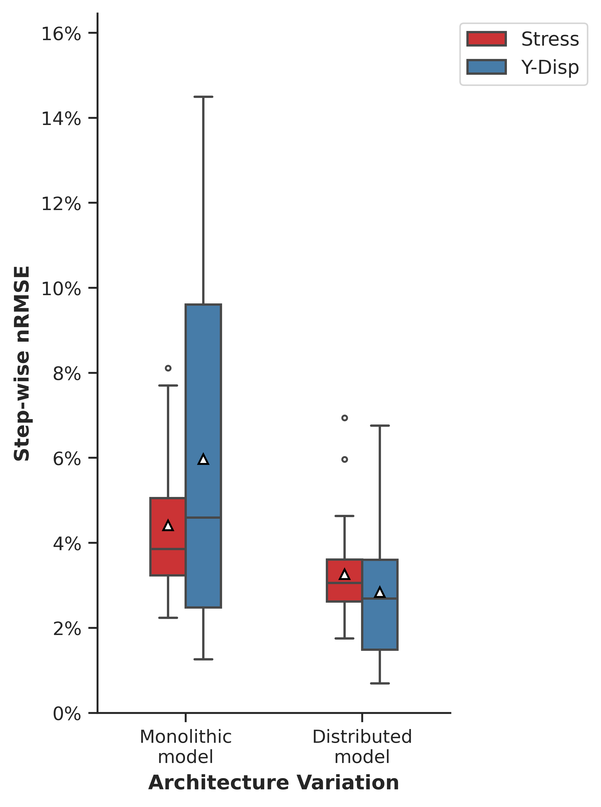

# PressNet++

Code, dataset tooling and pretrained checkpoints for **PressNet++: a staged multi-model surrogate for transient press forming**.
PressNet++ extends the [PressNet](https://github.com/AnK-Accelerated-Komputing/PressNet) benchmark (ASME IDETC/CIE 2025) from the pressing stage alone to the **complete 15 s forming cycle** (press, dwell, release), with stress prediction and a parallel temperature network.

| | |
|---|---|
| Paper | *(link to be added on publication)* |
| Dataset | *(Google Drive link coming soon)*, see [datasets/README.md](datasets/README.md) |
| Checkpoints | *(Google Drive link coming soon)*, see [checkpoints/README.md](checkpoints/README.md) |

## Current progress
- [x] Staged training and inference pipeline (press / dwell / release) for five architectures
- [x] Monolithic single-network baseline
- [x] Evaluation: one-step and rolled-out nMAE / nRMSE, step-wise curves, per-component errors
- [x] ANSYS to HDF5 data generation code
- [x] Visualisation: GIFs, ParaView rendering, Transolver slice analysis
- [ ] Temperature network training / inference code (to be added)
- [ ] Dataset download link
- [ ] Checkpoint download links

## Method in one picture

A press-forming cycle contains three physically different regimes. Instead of one network that has to learn all of them from the current state alone, PressNet++ trains **one network per regime** and hands the final mesh state of each stage to the next at inference time.


| Stage | Regime | Time | Simulation steps (dt = 0.01 s) |
|---|---|---|---|
| 1 | Press | 0 to 5 s | 1 to 500 |
| 2 | Dwell | 5 to 10 s | 501 to 1000 |
| 3 | Release (spring-back) | 10 to 15 s | 1001 to 1500 |
| T | Temperature (parallel) | 0 to 15 s | 1 to 1500 |

Every network is an autoregressive one-step simulator trained on every third solver step (skip-3, so one network call advances 0.03 s). The loss is a masked MSE on the normalised displacement increment plus the normalised von Mises stress of the blank nodes.



### Architectures

| Name in the code (`--model_name`) | Paper name | Family |
|---|---|---|
| `gcn` | GCN | graph |
| `regDGCNN_seg` | Reg-DGCNN | graph |
| `encode_process_decode` | MeshGraphNet | graph |
| `dilated_dgcnn` | Dilated-DGCNN | graph |
| `transolver` | Transolver | transformer |

### Headline results (in-distribution, rolled-out, staged, overall 0 to 15 s)

Values as reported in the manuscript; see the paper for standard deviations and the other splits.

| Model | y-displacement nRMSE | Stress nRMSE |
|---|---|---|
| GCN | 14.74 % | 14.65 % |
| Reg-DGCNN | 4.70 % | 4.51 % |
| MeshGraphNet | 6.87 % | 5.56 % |
| Dilated-DGCNN | 5.30 % | 5.24 % |
| Transolver | **3.20 %** | 4.51 % |

For Transolver on the coarse mesh the staged formulation lowers the rolled-out y-displacement nRMSE from 6.57 % (monolithic) to 3.20 %. On unseen die shapes MeshGraphNet is far more robust than Transolver (9.47 % vs 54.76 %).

## Repository structure

```
PressNet-plusplus/
├── README.md
├── environment.yml / requirements.txt   # dependencies
├── configs/
│   ├── train/                           # one JSON per architecture (paper hyperparameters)
│   └── inference/                       # three stage checkpoints per architecture and mesh
├── datasets/
│   ├── README.md                        # HDF5 layout, splits, download links
│   ├── download_data.py
│   └── data_gen/                        # raw ANSYS export -> HDF5 + meta JSON
├── checkpoints/
│   └── README.md                        # download links and expected layout
├── surrogateAI/
│   ├── README.md                        # detailed CLI reference
│   ├── train.py                         # train one stage network (or the monolithic baseline)
│   ├── inference.py                     # staged press -> dwell -> release rollout
│   ├── inference_monolithic.py          # single-network baseline rollout
│   ├── models/                          # GCN, Reg-DGCNN, MeshGraphNet, Dilated-DGCNN, Transolver
│   ├── utilities/                       # dataset, rollout, metrics, plots, GIFs
│   └── pointnet2_ops_lib/               # optional CUDA farthest-point sampling
├── scripts/
│   ├── train_all_stages.sh
│   └── evaluate_all_splits.sh
├── tools/
│   ├── paraview/                        # VTU export + ParaView rendering
│   └── slice_visualisation/             # Transolver learned-slice analysis
├── tutorials/                           # inspect the HDF5, generate your own data
└── docs/
    ├── reproducing_paper.md             # every table / figure -> command
    └── images/
```

## Installation

```bash
git clone <this repository>
cd PressNet-plusplus
conda env create -f environment.yml
conda activate pressnet_pp
```

`pytorch-scatter` and `torch-geometric` must match your PyTorch/CUDA build; if the conda solve fails, install PyTorch first and then follow the [PyG install guide](https://pytorch-geometric.readthedocs.io/en/latest/install/installation.html).

Optional, only for Dilated-DGCNN with fast farthest-point sampling (a slower pure-PyTorch fallback is used otherwise; needs a CUDA toolchain):

```bash
pip install ./surrogateAI/pointnet2_ops_lib
```

## Data and checkpoints

1. Download the dataset *(link coming soon)* and place the files as described in [datasets/README.md](datasets/README.md), e.g. `datasets/data/coarse/coarse_1500_train_val.h5` together with `coarse_1500_train_val_meta.json`.
2. Download the checkpoints *(link coming soon)* and unpack them into `checkpoints/` ([layout](checkpoints/README.md)).

```bash
python datasets/download_data.py --mesh coarse          # once the links are published
```

## Quick start: roll out a trained model

All commands run from `surrogateAI/`.

```bash
cd surrogateAI

# staged rollout (press -> dwell -> release) on the 35 in-distribution validation trajectories
python inference.py --config ../configs/inference/transolver_coarse.json \
    --data ../datasets/data/coarse/coarse_1500_train_val.h5 --split val \
    --out ../outputs/transolver_coarse/val --evaluate
```

This writes `rollout_stage_{1,2,3}.pkl`, the stitched `concatenated_rollout_all.pkl`, per-stage timings (`rollout_info.json`) and `evaluation/journal_metrics_summary.json` (mean +/- std nMAE / nRMSE of y-displacement and stress).

Useful variants:

```bash
# held-out splits: pass the extrapolation / unseen-shape file with --split test
python inference.py --config ../configs/inference/transolver_coarse.json \
    --data ../datasets/data/coarse/coarse_1500_unseen.h5 --split test --out ../outputs/transolver_coarse/unseen --evaluate

# one-step protocol (ground truth fed at every step, no error accumulation)
python inference.py ... --one_step

# monolithic baseline
python inference_monolithic.py --checkpoint ../checkpoints/coarse/transolver/monolithic \
    --core_model transolver --data ../datasets/data/coarse/coarse_1500_train_val.h5 --split val --out ../outputs/mono_val

# mixed architectures per stage
python inference.py --core_model gcn transolver dilated_dgcnn --stage1_ckpt ... --stage2_ckpt ... --stage3_ckpt ... --data ... --out ...

# ground truth vs prediction GIF
python -m utilities.animate_compare --rollout ../outputs/transolver_coarse/val/concatenated_rollout_all.pkl \
    --out ../outputs/gifs --index 0 --key stress
```

## Train from scratch

```bash
# three stage networks of one architecture on the coarse mesh (about 1260 epochs each)
bash scripts/train_all_stages.sh transolver coarse

# monolithic baseline = one network on the whole trajectory
STAGES="4" bash scripts/train_all_stages.sh transolver coarse

# a single stage with custom settings
cd surrogateAI
python train.py --config ../configs/train/transolver.json --stage 2 --slice 128
```

Optimisation settings (Adam, lr 1e-4, cosine annealing with warm restarts T0=20, Tmult=2, eta_min=1e-6, validation by rolled-out L1 every 20 epochs, best-L1 checkpoint) are identical for every architecture and stage and are stored in `configs/train/*.json`. Stages are independent, so they can be trained in parallel on different GPUs (`STAGES="1"`, `STAGES="2"`, `STAGES="3"`). Weights & Biases logging is optional (remove `--no_wandb` and set `use_wandb`).

## Visualisation tools

Both tools are fully argument-driven (`--help` on each).

```bash
# ParaView figures: rollout pickles -> VTU series -> rendered frames / movies
python tools/paraview/convert_pkls_to_vtu.py --model Transolver=<rollout.pkl> --samples all --out vtu
pvbatch tools/paraview/paraview_render.py --vtu-root vtu --out-root figures --models Transolver --skip 10

# Transolver learned-slice analysis (checkpoints and rollout passed directly)
python tools/slice_visualisation/slice_visualisation.py export --press-ckpt <dir> --dwell-ckpt <dir>     --release-ckpt <dir> --rollout <rollout.pkl> --out slices
```

Details: [tools/slice_visualisation/README.md](tools/slice_visualisation/README.md).

## Reproducing the paper

[docs/reproducing_paper.md](docs/reproducing_paper.md) maps every table and figure (benchmark, staged vs monolithic, ablations, extrapolation and unseen shapes, one-step vs rolled-out, mesh transfer, timing, slice analysis) to the command that produces it.

## Citation

If you use the PressNet++ code, please cite:

```bibtex
@article{pressnetpp2026,
  title   = {PressNet++: a staged multi-model surrogate for transient press forming},
  author  = {TBA},
  journal = {TBA},
  year    = {2026}
}
```

and the PressNet dataset:

```bibtex
@inproceedings{PRESSNET2025,
  author    = {Prince Panta and Saroj Belbase and Rachit Rijal and Bipin Shrestha and Nirmal Prasad Panta and Dikshya Parajuli and Rujal Acharya and Saugat Kafley and Amit Regmi and Ken Igeta and Akio Tanaka and Christopher McComb},
  title     = {{PRESSNET: A Forming Dataset for Structural Simulation in Pressed Blanks with Deep Learning Benchmarks}},
  booktitle = {Proceedings of the ASME 2025 International Design Engineering Technical Conferences and Computers and Information in Engineering Conference (IDETC/CIE 2025)},
  year      = {2025},
  address   = {Anaheim, CA, USA},
  paperid   = {IDETC2025-163821},
  publisher = {American Society of Mechanical Engineers (ASME)},
  doi       = {10.1115/DETC2025-163821},
  url       = {https://doi.org/10.1115/DETC2025-163821}
}
```

## License

*(to be added)*
