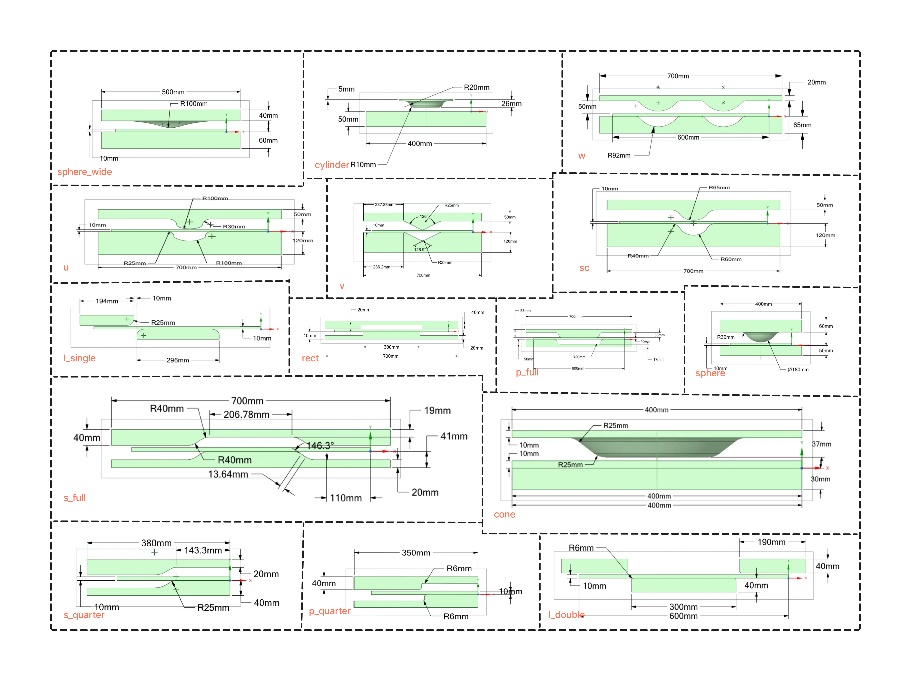

# PressNet dataset

150 transient ANSYS simulations of a blank pressed between two dies: 15 die shapes x 10 parametric variations, 1500 solver steps of 0.01 s (5 s press, 5 s dwell, 5 s release). Each trajectory is provided at three mesh resolutions (coarse, medium, fine). Per node and step: world position and von Mises stress. Die geometry and parameter ranges are in the paper's appendix.



## Download

| Mesh | Files | Link |
|---|---|---|
| coarse | `coarse_1500_train_val.h5` (+ `_meta.json`), `coarse_1500_extrapolation.h5`, `coarse_1500_unseen.h5` | *(coming soon)* |
| medium | same pattern | *(coming soon)* |
| fine | same pattern | *(coming soon)* |
| raw ANSYS exports | per-trajectory folders | *(coming soon)* |

Place each mesh in its own folder:

```
datasets/data/
├── coarse/
│   ├── coarse_1500_train_val.h5            + coarse_1500_train_val_meta.json
│   ├── coarse_1500_extrapolation.h5        + coarse_1500_extrapolation_meta.json
│   └── coarse_1500_unseen.h5               + coarse_1500_unseen_meta.json
├── medium/
└── fine/
```

`python datasets/download_data.py --mesh coarse` downloads and arranges these once the links are filled in.

## Splits

| File | Trajectories | Content | Used for |
|---|---|---|---|
| `*_train_val.h5` | 117 | 13 die shapes | split 70/30 at trajectory level with a fixed seed (42) into 82 train / 35 validation; `--split val` gives the 35 in-distribution evaluation trajectories |
| `*_extrapolation.h5` | 13 | one withheld parametric variation of each of the 13 seen shapes | `--split test` |
| `*_unseen.h5` | 20 | two die shapes (`w`, `rect`) with all their variations | `--split test` |

`utilities/dataset.py` does the 70/30 split itself (`random.seed(42)`, shuffle of the group names, first 70 % train); `--split test` uses every group of the file.

## HDF5 layout

One group per trajectory (`group_0`, `group_1`, ...):

```
group_<i>/
├── cells        (n_cells, 4)  float32   tetrahedra, 0-based node indices
├── mesh_pos     (n_nodes, 3)  float32   reference (undeformed) node positions, mm
├── node_type    (n_nodes, 1)  float32   0 = NORMAL (blank), 1 = OBSTACLE (die), 3 = HANDLE
└── step_<n>/    n = 1 ... 1500
    ├── world_pos (n_nodes, 3) float32   deformed node positions, mm
    └── stress    (n_nodes, 1) float32   von Mises stress, MPa
```

The matching `<name>_meta.json` has one entry per group (`data type`, `number of nodes`, `number of cells`, `number of steps`, `del time`, `simulation_time`, geometric parameters of the variation). Only `NORMAL` nodes are supervised and scored; die and handle nodes follow the prescribed tool motion.

`dataset.py` caches the processed tensors next to the HDF5 file as `<name>_<split>_<stage>.pt` (stage 1, 2, 3 = press, dwell, release; 4 = whole trajectory). Delete these files if you change the dataset or the temporal stride.

## Creating your own data

See [../tutorials/generate_data.md](../tutorials/generate_data.md) and `data_gen/`. To look at a file: `python tutorials/inspect_h5.py datasets/data/coarse/coarse_1500_train_val.h5`.
